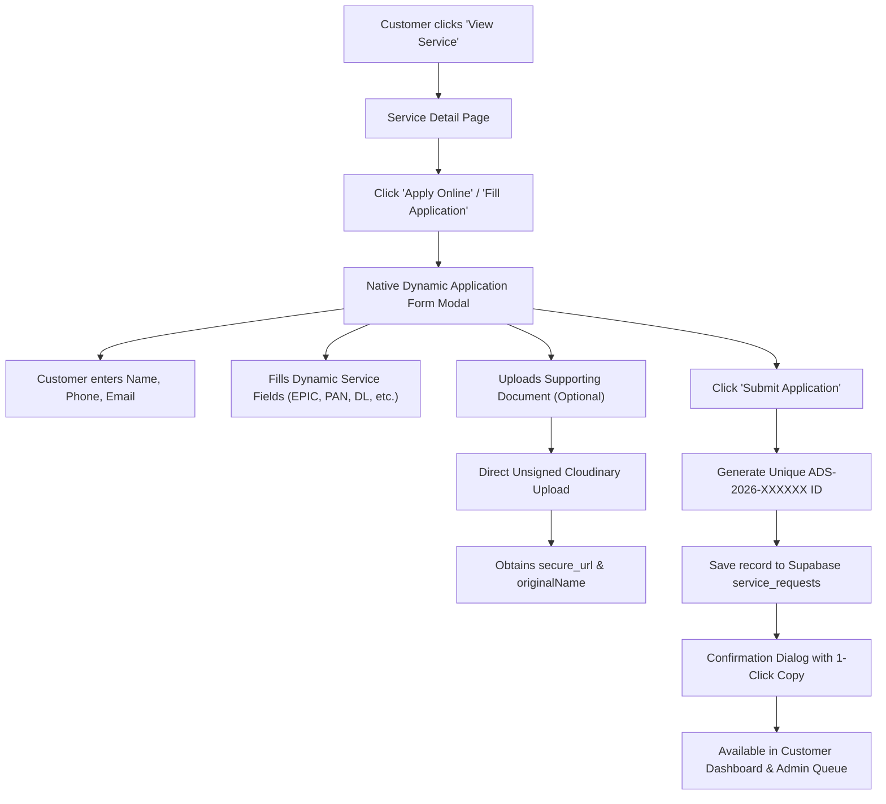

# Master Architecture & Implementation Plan: Native Service Forms & Dynamic Builder

## Executive Summary & Objectives
We are removing all external Google Form dependencies and building **100% native on-site application forms** for every service on Apna Digital Service. 

Key deliverables:
1. **Native Dynamic Forms**: Each service has its own custom application form rendered directly on the platform.
2. **Admin Form Field Builder**: In the Admin Portal, administrators can dynamically define, edit, add, and remove custom fields for any service (Text, Number, Date, Select dropdowns, File Uploads).
3. **Cloudinary Document Uploads**: Users can upload supporting documents (Aadhaar, old card copy, photos, RC records) during application submission. If no document is uploaded, the UI explicitly shows **"No document available"**.
4. **Unique Application Number Generator**: Automatically generates unique, trackable application numbers (e.g., `ADS-2026-XXXXXX`) for each submission.
5. **Removal of Obsolete Logic**:
   - Remove Google Form URL checks that hid service cards from the homepage.
   - Remove the old 2-step prompt modal (`FormInstructionModal`).
   - "View Service" top button ("Apply Online / Fill Application") immediately opens the native service application form.
6. **Database Schema & Table Clean-Up**: Clean migration for `public.services` and `public.service_requests` tables, removing Google Form/Sheet columns and adding `form_fields` and `form_data` JSONB columns.

---

## 1. Database Schema Changes & Cleanup Plan

### 1.1 `public.services` Table Updates
Remove Google Form/Sheet URLs and store the dynamic form schema directly inside each service record.

| Column | Type | Change / Purpose |
| :--- | :--- | :--- |
| `form_url` | TEXT | **DROP / DEPRECATE** (No longer needed) |
| `spreadsheet_url` | TEXT | **DROP / DEPRECATE** (No longer needed) |
| `form_fields` | JSONB | **NEW**: Stores array of field definitions configured by Admin |

**Structure of `form_fields` JSONB:**
```json
[
  {
    "id": "epic_number",
    "label": "Voter ID / EPIC Number",
    "type": "text",
    "placeholder": "e.g. WBF1234567 or State Assembly Details",
    "required": true,
    "options": []
  },
  {
    "id": "relative_name",
    "label": "Father's / Husband's Name",
    "type": "text",
    "placeholder": "Name as per voter records",
    "required": false,
    "options": []
  },
  {
    "id": "state_name",
    "label": "State / UT",
    "type": "select",
    "placeholder": "Select State",
    "required": true,
    "options": ["Odisha", "Bihar", "West Bengal", "Uttar Pradesh", "Delhi", "Maharashtra", "Other"]
  },
  {
    "id": "supporting_doc",
    "label": "Upload Existing Slip / ID Proof (Optional)",
    "type": "file",
    "placeholder": "Upload PDF or Image",
    "required": false,
    "options": []
  }
]
```

### 1.2 `public.service_requests` Table Updates
Store the submitted user data, uploaded documents, and generated application number.

| Column | Type | Purpose |
| :--- | :--- | :--- |
| `application_id` | TEXT (UNIQUE) | e.g., `ADS-2026-784912` (Unique Application Number) |
| `service_id` | TEXT | Reference to service ID (e.g. `voter-id`, `pan-card`) |
| `service_name` | TEXT | Display name of service |
| `customer_name` | TEXT | Applicant Full Name |
| `customer_email` | TEXT | Customer Email |
| `customer_phone` | TEXT | Customer WhatsApp 10-digit number |
| `form_data` | JSONB | **NEW**: Dynamic key-value pairs matching service's `form_fields` |
| `user_document_url` | TEXT | **NEW**: Cloudinary secure URL of file uploaded by customer (if any) |
| `user_document_name`| TEXT | **NEW**: Original file name uploaded by customer (if any) |
| `document_url` | TEXT | Admin-issued verified PDF delivery URL |
| `document_name` | TEXT | Admin-issued verified PDF file name |
| `status` | TEXT | `Request Received`, `Under Review`, `Processing`, `Completed`, `Unable to Process` |
| `operator_note` | TEXT | Internal notes / customer status remarks |

### 1.3 Storage Bucket / Cloudinary Integration
- **Cloudinary Setup**:
  - We use the existing configured unsigned upload preset in `.env`:
    - `VITE_CLOUDINARY_CLOUD_NAME=m1gqubzu`
    - `VITE_CLOUDINARY_UPLOAD_PRESET=apna_documents`
  - Customer uploads will be routed to folder: `apna_documents/user_uploads/`
  - Admin issued PDFs remain in: `apna_documents/issued_pdfs/`
  - Max upload size: 15MB. Allowed formats: PDF, JPG, PNG, WEBP.
- **Supabase Storage Bucket (Optional / Backup)**:
  - Create Supabase storage bucket `service-documents` with public read access for submitted documents.

---

## 2. Customer Application Form Workflow



### Key UI Features for Customer Form:
1. **Zero Google Forms**: The entire form is built into the website with a modern, glassmorphic UI.
2. **Direct Action**: Clicking "View Service" -> "Fill Application" or "Apply Online" opens the form directly without any confusing intermediate 2-step prompt modals.
3. **Smart Upload Component**:
   - Drag & drop or click to select PDF / Image.
   - Real-time progress bar (0% -> 100%).
   - Clear file preview with remove button.
   - If user chooses not to upload, form still submits cleanly.
4. **Instant Unique Application ID**:
   - Format: `ADS-2026-XXXXXX` (where XXXXXX is an uppercase alphanumeric / 6-digit random token).
   - Displayed with copy-to-clipboard button and direct link to "My Dashboard".

---

## 3. Admin Dynamic Form Field Builder

In the Admin Portal (`/admin` -> Services Tab -> Add Service / Edit Service):

### 3.1 What Admin Can Configure for Every Service:
- **Basic Info**: Title, Hindi Title, Short Name, Slug, Badge, Badge Color, Icon, Support Phone, Description, Workflow, Requirements.
- **Dynamic Form Fields Builder**:
  - Admin can click `+ Add Custom Field`.
  - For each field, Admin configures:
    1. **Field Label**: e.g., "Vehicle Registration Number (RC)"
    2. **Field ID / Key**: auto-slugified (e.g., `vehicle_rc_number`)
    3. **Field Type**:
       - `Text` (single line text input)
       - `Number` (numeric digits)
       - `Date` (calendar picker)
       - `Select Dropdown` (Admin provides options like: `Two Wheeler, Four Wheeler, Commercial`)
       - `Textarea` (multi-line notes / address)
       - `File Upload` (document / photo / ID proof)
    4. **Required**: Checkbox (Yes / No)
    5. **Placeholder**: Custom helper text
  - Reorder, edit, or delete existing fields with 1 click.
  - **Live Preview Panel**: Shows how the form will look to customers in real time.

---

## 4. Admin Verification Queue & Applications Table

In Admin Dashboard (`/admin` -> Verification Queue):
1. **Applications Table Column**:
   - `App ID & Date` (e.g. `ADS-2026-489102`)
   - `Service Name`
   - `Customer Name & WhatsApp`
   - `Customer Uploaded Document`:
     - If document was uploaded: Clickable `[View Document (PDF/Image)]` button.
     - If no document was uploaded: Styled badge: **`No document available`** (as specifically requested!).
   - `Status Badge` (`Request Received`, `Under Review`, `Completed`, etc.)
   - `Delivered PDF`: Shows whether the final issued PDF has been attached by Admin.
2. **Application Detail Modal (When Admin clicks a row)**:
   - Full customer identity details.
   - **All Custom Form Answers**: Rendered cleanly in an organized question-and-answer list.
   - **Customer Document Section**:
     - Shows file preview/link OR **"No document available"** message.
   - **Admin Delivery Actions**:
     - Status changer.
     - Operator remarks input.
     - Upload finalized verified document PDF via Cloudinary to deliver to user's dashboard and WhatsApp.

---

## 5. Clean-Up & Google Forms Removal Checklist

1. **Delete / Retire `FormInstructionModal.jsx`**:
   - Remove the old 2-step prompt logic that opened Google Forms.
2. **`ServicesSection.jsx`**:
   - Remove `&& Boolean(s.formUrl && s.formUrl.trim())` so all active service cards show up properly.
   - Remove "Google Form" button; replace with "Apply Online" which opens the native modal.
3. **`ServiceDetailPage.jsx`**:
   - Remove "Open Google Form" button and replace with "Apply Online / Fill Application".
4. **`CustomerDashboardPage.jsx`**:
   - Remove copy mentioning "Complete the official Google Form with this email".
   - Replace with native instructions and display submitted `form_data` and customer documents.
5. **`HowItWorksPage.jsx`, `FAQPage.jsx`, `PolicyPage.jsx`**:
   - Clean up any outdated text referencing external Google Forms.
6. **`servicesData.js` & Supabase Seeds**:
   - Remove `formUrl` and `spreadsheetUrl` properties.
   - Populate rich default `form_fields` for the initial 7 core services.

---

## 6. Execution Plan & Next Steps

| Phase | Tasks |
| :--- | :--- |
| **Phase 1: DB Schema & Migration** | Write the SQL script to alter `services` & `service_requests` tables, create `form_fields` and `form_data` columns, and configure default seeds. |
| **Phase 2: Admin Form Field Builder** | Update `AdminServiceModal.jsx` to let Admin dynamically create, edit, and delete fields for any service. |
| **Phase 3: Native Service Application Form** | Upgrade `RequestModal.jsx` into a full dynamic form renderer supporting dynamic fields, Cloudinary user upload, and unique Application ID generation. |
| **Phase 4: Customer Detail & Action Updates** | Update `ServiceDetailPage.jsx`, `ServicesSection.jsx`, and `App.jsx` to remove Google Forms & `FormInstructionModal`, wiring up direct application flow. |
| **Phase 5: Admin Queue & Document Review** | Update `AdminApplicationModal.jsx` and `AdminDashboardPage.jsx` to show submitted dynamic fields and customer documents or "No document available". |
| **Phase 6: Verification & Testing** | Test end-to-end flow: creating a service with custom fields as Admin -> applying as customer with and without doc -> reviewing and delivering in Admin. |
