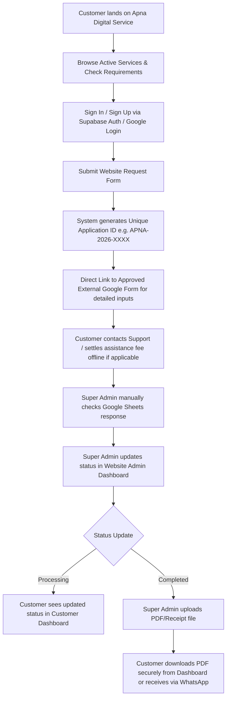

# APNA DIGITAL SERVICE (APNA PAN AGENCY)
## Master Website Development Plan & Technical Specification

> **Platform Status**: Private Digital Documentation Assistance & Facilitation Platform  
> **Official Domain**: `www.apnadigitalservice.com`  
> **Original Source Document**: `docs/Apna_Digital_Service_Website_Development_Plan.pdf` (Archived in repository)  
> **Revised Workflow**: **NO ONLINE PAYMENT GATEWAY INTEGRATION** (Payment/fee settlement is handled directly/offline via WhatsApp or verified by Super Admin; website handles request tracking, form links, customer accounts, and secure PDF delivery).

---

## 1. Project Overview & Core Vision
Apna Digital Service (Apna Pan Agency) is a modern, fast, and accessible digital documentation assistance platform. It bridges the gap between citizens needing assistance with document downloads (PAN, Voter ID, Driving Licence, RC) and backend operations.

### Key Tenets
1. **Private Platform Disclaimer**: The platform is strictly privately operated and is **NOT a government entity, department, or official government portal**.
2. **Facilitation Only**: The platform assists citizens with requests; it does **not guarantee approval, issuance, or modification**, nor does it promise fixed processing times.
3. **No Sensitive Government Passwords or OTPs**: Never ask for or store government login passwords, bank details, or OTPs.
4. **No Automated Payment Gateway**: There is **no online payment gateway, checkout cart, or payment callback automation** on the website. Customers submit their request record, complete the linked Google Form, settle any assistance fee directly via WhatsApp/offline with support, and Super Admin manually verifies and marks the request ready.
5. **Direct Document Delivery**: The Super Admin uploads final PDF/receipt files securely, and customers can view and download them directly from their private customer dashboard or receive updates via WhatsApp.

---

## 2. Branding & Visual Identity
- **Logo**: 3D Tricolour-inspired emblem featuring the stylized letter "A" in Saffron Orange and India Green with a glossy orbit ring on an ivory/off-white badge (`/logo.png`).
- **Primary Color Palette**:
  - **Saffron Orange**: `#F97316` / `#EA580C`
  - **India Green / Emerald**: `#16A34A` / `#15803D`
  - **Deep Navy / Charcoal**: `#0F172A` / `#1E293B`
  - **Clean Background / Off-White**: `#F8FAFC` / `#FFFFFF`
  - **Card / Glass Accent**: Pure white with subtle border tints (`rgba(226, 232, 240, 0.8)`) and soft modern shadows.
- **Tone**: Clean, professional, trustworthy, fast, and extremely easy to understand in Hindi & English (Hinglish guidance for maximum reach).

---

## 3. Active Services & External Form Handlers
Currently, **4 Core Services** are fully prepared with approved Google Form links and dedicated support helplines:

| # | Service Name | Icon / Badge | Approved Google Form Link | Dedicated Phone / WhatsApp | Status |
|---|---|---|---|---|---|
| 1 | **PAN Card PDF Download Assistance** | 🪪 PAN PDF | `https://forms.gle/o2AfsRZuxcPpYBnL9` | `+91 9124494239` | **ACTIVE** |
| 2 | **Voter ID / e-EPIC PDF Download Assistance (Without OTP)** | 🗳️ Voter PDF | `https://forms.gle/dR8S5SBYRM9qrfvF8` | `+91 9124494239` | **ACTIVE** |
| 3 | **Driving Licence (DL) PDF Download Assistance** | 🚗 DL PDF | `https://forms.gle/DrgRW485k9QDQTf28` | `+91 9078620775` | **ACTIVE** |
| 4 | **Vehicle Registration Certificate (RC) PDF Download Assistance** | 🚘 RC PDF | `https://forms.gle/ffutHMr4xa6yDMHZA` | `+91 9078620775` | **ACTIVE** |
| 5 | **Ayushman Card — New Member Addition Assistance** | 🏥 Ayushman | *Owner to confirm form link* | `+91 8018246567` / `9124494239` | *Upcoming / Phase 2* |
| 6 | **Ayushman Card — Correction Assistance** | ✏️ Correction | *Owner to confirm form link* | `+91 8018246567` / `9124494239` | *Upcoming / Phase 2* |
| 7 | **Ayushman Card — e-KYC Assistance** | 🛡️ e-KYC | *Owner to confirm form link* | `+91 8018246567` / `9124494239` | *Upcoming / Phase 2* |

---

## 4. End-to-End User & Operational Flow

### Operational Rule for Google Forms
- There is **no automated API matching or webhook** from Google Forms.
- The website stores the customer's request record (`customer_name`, `customer_email`, `customer_phone`, `service_id`, `application_id`).
- Super Admin opens the authorized response spreadsheet, searches by phone/email/name, verifies submission, and updates the website status manually.

---

## 5. Request Status Lifecycle

1. **Request Received** *(Automatic)*: Created when the customer submits the on-site request.
2. **Awaiting Form Verification** *(Super Admin)*: Checked when customer has not yet filled the external Google Form or admin is locating it.
3. **Under Review** *(Super Admin)*: Form response located; details being verified.
4. **Additional Information Required** *(Super Admin)*: Discrepancy in data; customer contacted via WhatsApp/phone.
5. **Processing** *(Super Admin)*: Request is in progress via authorized assistance channels.
6. **Completed** *(Super Admin)*: Assistance complete and PDF/receipt file uploaded to dashboard.
7. **Unable to Process** *(Super Admin)*: Reason logged (e.g. invalid document number or ineligible records) without exposing sensitive data.

---

## 6. Authentication & User Roles (Updated Scope)
- **Authentication**: **Supabase Auth** with:
  - Email & Password login / registration with password reset.
  - **Google OAuth / Social Sign-In** (and Firebase config compatibility for hybrid setups).
- **User Roles**:
  - **Customer**: Can view only their own requests, submit new service requests, and download only their own uploaded PDF files.
  - **Admin**: Read-only access to view all applications, search by Application ID / phone / name.
  - **Super Admin**: Full control to update request status, add manual verification notes, upload/replace/delete result files, and manage service settings.

---

## 7. Recommended Technical Architecture
- **Frontend**: React (Vite) + Vanilla Modern CSS Design System + Lucide Icons.
- **Hosting**: Cloudflare Pages / Static Hosting.
- **Backend / Database**: Supabase (PostgreSQL with Row Level Security - RLS).
- **Storage**: Cloudinary / Supabase Storage (Private authenticated delivery with signed short-lived URLs for customer documents).
- **Disclaimers & Compliance**: Prominently visible on every page, header, and footer.
